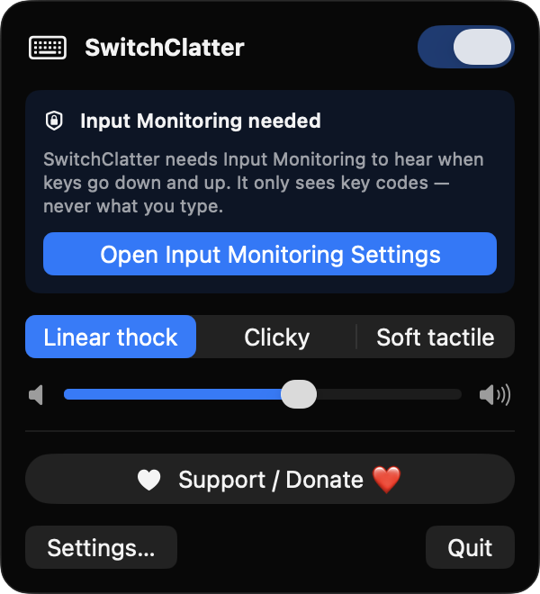
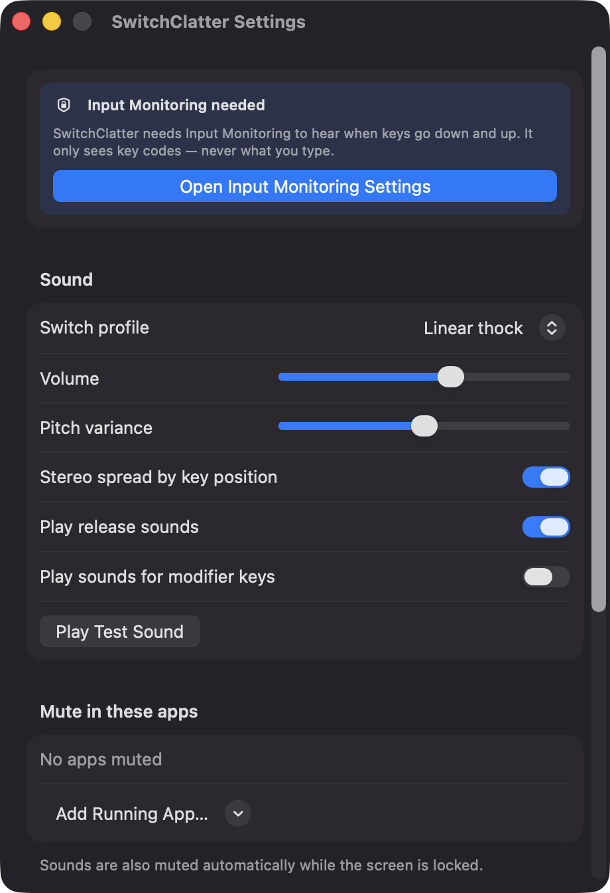
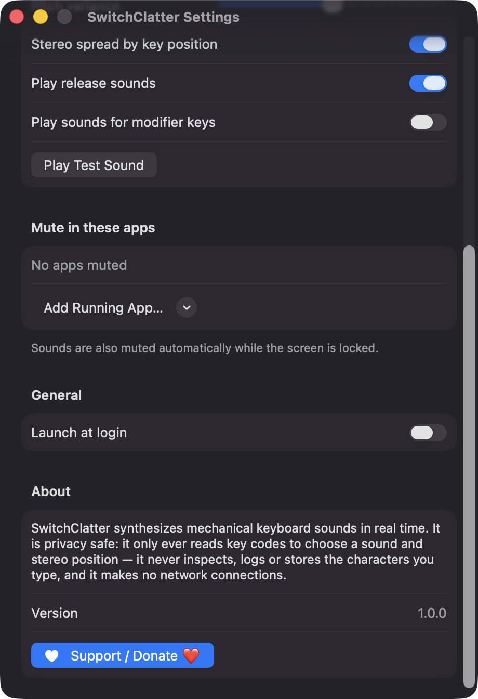

# SwitchClatter

**🌐 Website:** [turhe123.github.io/switch-clatter](https://turhe123.github.io/switch-clatter/)

Plays satisfying mechanical keyboard click sounds as you type on any Mac keyboard.


## Why

SwitchClatter is a free, open-source, 100% native, backend-free alternative to paid utilities in the *Audio* category. It was inspired by Klack ($4.99 one-time), a menu bar app that plays mechanical switch sounds as you type. SwitchClatter is a clean-room implementation: every sound is synthesized on your Mac at launch, so there are no audio assets to license, no accounts, and no network connections.

## Features

- **Global key sounds** – a listen-only `CGEventTap` hears key presses in any app, from any keyboard (built-in or external).
- **Down and release sounds** – a click on key down and a softer one on key up. The release sound can be turned off.
- **Three synthesized switch profiles** – *Linear thock*, *Clicky* and *Soft tactile*. Each is built from decaying sine bodies, overtones and filtered noise bursts.
- **Per-key-type sounds** – space, return, delete and modifier keys each get their own voice.
- **Pitch variation** – 7 pre-generated pitch variants per sound, with an adjustable variance slider, so fast typing doesn't sound repetitive.
- **Stereo spread** – optional panning based on where the key sits on the keyboard.
- **Low-latency, overlapping playback** – `AVAudioEngine` with a pool of 24 player nodes and a small IO buffer request, so rapid typing doesn't cut sounds off.
- **Modifier key sounds** – optional, off by default.
- **Auto-mute** – sounds are muted while the screen is locked, and while any app on your "Mute in these apps" list is frontmost. Apps are picked from your running apps.
- **Menu bar app** – on/off toggle, profile picker (with preview), volume slider, Settings and Quit. The icon dims when the app is off or permission is missing.
- **Settings window** – profile, volume, pitch variance, stereo spread, release sounds, modifier sounds, mute list, launch at login, and a test sound button.
- **Launch at login** via `SMAppService`.
- **Robust** – ignores key auto-repeat, re-enables the event tap if the system disables it, restarts audio when the output device changes, and shows an error row with a Retry button if the audio engine can't start.
- **Privacy-safe** – only hardware key codes are read, to pick a sound and a stereo position. Typed characters are never inspected, logged or stored.

## Screenshots

<p align="center"></p>

<p align="center"><em>The SwitchClatter menu bar popover with the on/off toggle, switch profile picker (Linear thock, Clicky, Soft tactile), volume slider and a one-click Input Monitoring setup prompt.</em></p>

<p align="center"></p>

<p align="center"><em>The Settings window&#x27;s Sound section: switch profile, volume, pitch variance, stereo spread, release and modifier sounds, and a test sound button.</em></p>

<p align="center"></p>

<p align="center"><em>Further down in Settings: a per-app mute list, launch at login, and a privacy note confirming the app only reads key codes.</em></p>

## Install

1. Download `SwitchClatter-macOS.zip` from the [latest release](https://github.com/turhe123/switch-clatter/releases/latest).
2. Unzip it and move `SwitchClatter.app` to `/Applications`.
3. Because the app is open source and not notarized, clear the quarantine flag:

   ```bash
   xattr -cr /Applications/SwitchClatter.app
   ```

4. Right-click the app and choose **Open** the first time you launch it.

SwitchClatter lives in the menu bar (there is no Dock icon). Requires macOS 14 or later.

## Build from source

Requires Xcode with Swift 5.9+ and [XcodeGen](https://github.com/yonaskolb/XcodeGen).

```bash
brew install xcodegen
xcodegen generate
xcodebuild -project SwitchClatter.xcodeproj -scheme SwitchClatter -configuration Release -derivedDataPath ./build build
```

The app is produced at `build/Build/Products/Release/SwitchClatter.app`.

## Permissions

SwitchClatter asks for one permission:

- **Input Monitoring** – required to hear key down and key up events system-wide through a listen-only event tap. The app shows a prominent button that opens the correct pane in System Settings, then detects when access is granted. It only reads key codes, never what you type. Secure text fields such as password inputs don't deliver events to event taps at all.

It does **not** request Accessibility, Screen Recording or Microphone access. Playing sound needs no permission. The optional "Launch at login" setting registers a login item through macOS, which may show up in System Settings → General → Login Items.

## Support ❤️

SwitchClatter is free and always will be. If you enjoy it, you can support development:

[Support Or (Leo) Davidai ❤️ on Ko-fi](https://ko-fi.com/leodavidai)

There is also a **Support / Donate ❤️** button in the app's menu and Settings window.

## License

MIT © Or Davidai Bachar
